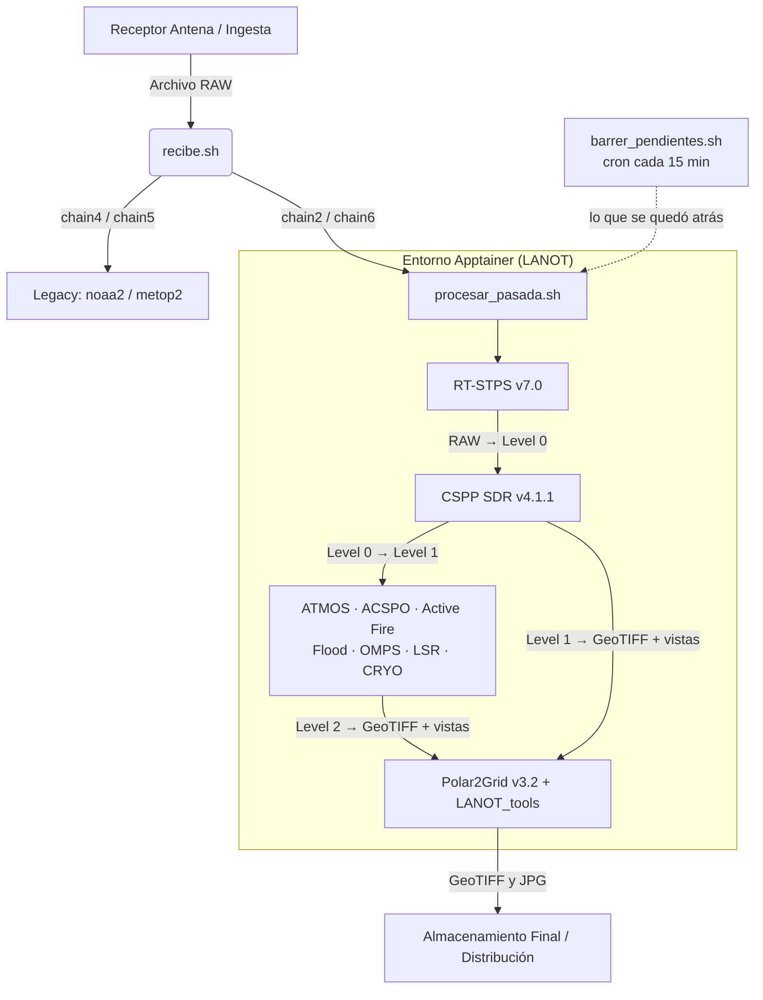

# LANOT_procesamiento_polar

**Orquestación de contenedores Apptainer para el procesamiento operativo de satélites de la serie JPSS (Suomi-NPP, NOAA-20 y NOAA-21).**

  

---

## 📋 Descripción del Proyecto

Este repositorio contiene la "Infraestructura como Código" (IaC) de la cadena de procesamiento de imágenes satelitales polares del **Laboratorio Nacional de Observación de la Tierra (LANOT)**.

El objetivo es migrar de scripts monolíticos en servidor ("bare metal") a una arquitectura modular basada en contenedores **Apptainer** (anteriormente Singularity). Esto garantiza:
* **Reproducibilidad:** Entornos idénticos a los validados por SSEC/Wisconsin.
* **Soporte Moderno:** Capacidad para procesar NOAA-21 (JPSS-2).
* **Aislamiento:** Eliminación de conflictos de bibliotecas entre cadenas de procesamiento antiguas y nuevas.

**No contiene software científico ni datos**: solo recetas, scripts, plantillas XML y documentación. Los tarballs oficiales de CIMSS/SSEC y NASA DRL no están versionados; lo que sí está es el manifiesto de cuáles hacen falta, en `contenedores/tarballs.tsv`.

### 🛰️ Satélites Soportados
* **Suomi-NPP**
* **NOAA-20 (JPSS-1)**
* **NOAA-21 (JPSS-2)**

---

## 🏗️ Arquitectura del Flujo

`recibe.sh` recibe el RAW de la antena y enruta; `procesar_pasada.sh` encadena los once eslabones de una pasada, con barreras entre niveles y hasta tres etapas simultáneas; `barrer_pendientes.sh` va en cron y recoge lo que se quedó atrás.



`geotiff/` son datos (float32) y `vistas/` son JPG decorados con logo y sello de tiempo: no se mezclan.

---

## 🚀 Requisitos Previos

Para desplegar este sistema en un servidor nuevo, se requiere:

*   **Sistema Operativo:** Rocky Linux 8/9 o RHEL compatible.
*   **Motor de Contenedores:** `Apptainer` instalado (`dnf install apptainer`).
*   **Credenciales:** cuenta en el sitio de descargas de CIMSS/SSEC, y otra en la NASA DRL para RT-STPS. Los dos piden registro.

---

## 🛠️ Puesta en marcha

### 1. Clonar y ver qué falta

```bash
git clone https://github.com/LANOT-UNAM/LANOT_procesamiento_polar.git
cd LANOT_procesamiento_polar

./contenedores/obtener_tarballs.sh              # qué falta, qué sobra, qué no cuadra
./contenedores/obtener_tarballs.sh --descargar  # qué bajar y de dónde
```

Los dos sitios piden registro, así que la descarga es manual: el script dice exactamente qué archivos faltan, de qué sitio salen y dónde dejarlos. `--verificar` confirma después que llegaron completos.

### 2. Compilar las imágenes

Hay **orden de compilación**: todas las recetas parten de una imagen base común. `construir.sh` lo resuelve.

```bash
./contenedores/construir.sh                    # lista lo disponible
./contenedores/construir.sh cspp_sdr_v4.1.1    # compila esa receta y su base

# El destino de los .sif se elige con DESTINO; los scripts los buscan en /opt/containers
DESTINO=/opt/containers ./contenedores/construir.sh polar2grid_v3.2-mapdrawer
```

### 3. Preparar el servidor (una vez)

```bash
./scripts/preparar_servidor.sh --verificar   # audita sin tocar nada
sudo ./scripts/preparar_servidor.sh          # directorios, estáticos, XML, leapsec, cachés
```

Los tarballs de datos estáticos se borran después de extraerlos y comprobar que el destino quedó poblado: son decenas de GB que duplicarían lo que ya vive en `/data/opt`. Los bundles de software sí se conservan, porque son la entrada de `apptainer build`.

### 4. Instalar el código de operación (en cada despliegue)

```bash
sudo ./scripts/instalar.sh    # copia a /opt/lanot/polares
```

La cadena se ejecuta desde `/opt/lanot/polares/scripts/`, **no** desde el clon: así un `git pull` a media pasada no cambia el script que se está ejecutando. `VERSION` anota de qué commit salió.

El único punto de contacto con la antena, que invoca una ruta fija:

```bash
sudo ln -sf /opt/lanot/polares/scripts/recibe.sh /home/lanotadm/bin/recibe.sh
```

### 5. Comprobar que hay versión nueva de algún paquete

CSPP no tiene lista de correo ni RSS, así que nadie avisa. La portada sí es pública:

```bash
./contenedores/obtener_tarballs.sh --novedades   # va bien en un cron mensual
```

---

## 📂 Estructura del Repositorio

```
.
├── config/         # grid.yaml (rejillas propias) y plantillas XML de RT-STPS
├── contenedores/   # recetas .def, construir.sh, y el manifiesto de tarballs
├── docs/           # documentación técnica y manuales
├── referencia/     # código del servidor viejo: se consulta, no se ejecuta
├── scripts/        # la cadena: run_*.sh, orquestador, instalación
├── .gitignore      # exclusión de binarios y datos
├── LICENSE         # GPLv3
└── README.md       # este archivo
```

`docs/estado_y_pendientes.md` es el documento vivo: qué eslabón se ha probado con datos reales, qué falta y qué preguntas siguen abiertas.

---

## ⚙️ Mantenimiento Operativo

### Datos auxiliares dinámicos
Cada software tiene **su propio caché** bajo `/data/ancillary`, y no se comparten: el podador de ATMOS borra por directorio y se llevaría el de SDR entero. Los refrescan dos tareas de cron, `update_sdr_daily.sh` y `update_atmos_ancillary.sh`.

### Leap seconds
`/data/ancillary/common/leapsec.dat` sale del contenedor de RT-STPS, que es la única fuente con el formato correcto garantizado, y lo refresca `update_sdr_daily.sh`. **Nunca se sustituye por uno improvisado**: un leapsec inventado no falla, fecha mal los datos en silencio.

---

## 🤝 Contribución

Este es un proyecto interno del LANOT. Se trabaja **directo sobre `main`**, sin ramas ni Pull Requests: `tahan` es servidor de desarrollo y no el que está conectado a la antena, así que la ceremonia solo estorba. El ciclo es editar, `git push`, `git pull` en tahan, `instalar.sh` y correr.

El `push` lo hace siempre Alejandro: revisar lo que sale es como se mantiene al tanto de por dónde va el proyecto.

Si algún día `main` vuelve a alimentar la antena directamente, hay que revisar esta regla.

---

## 📜 Licencia y Créditos
*   **Código de Orquestación:** Distribuido bajo licencia GNU GPLv3.
*   **Software Base:**
    *   CSPP (SDR, ATMOS, LSR, CRYO, ACSPO, Active Fire, Flood, OMPS) y Polar2Grid: University of Wisconsin-Madison (SSEC/CIMSS).
    *   RT-STPS: NASA Direct Readout Laboratory (DRL).

---
*Laboratorio Nacional de Observación de la Tierra (LANOT) - UNAM, 2026.*
