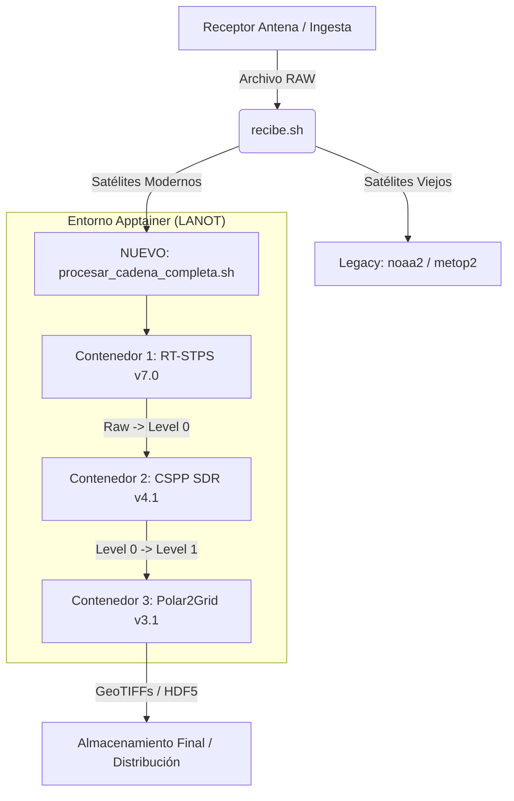

# LANOT_procesamiento_polar

**Orquestación de contenedores Apptainer para el procesamiento operativo de satélites de la serie JPSS (Suomi-NPP, NOAA-20 y NOAA-21).**

  

---

## 📋 Descripción del Proyecto

Este repositorio contiene la "Infraestructura como Código" (IaC) necesaria para modernizar la cadena de procesamiento de imágenes satelitales polares en el **Laboratorio Nacional de Observación de la Tierra (LANOT)**.

El objetivo es migrar de scripts monolíticos en servidor ("bare metal") a una arquitectura modular basada en contenedores **Apptainer** (anteriormente Singularity). Esto garantiza:
* **Reproducibilidad:** Entornos idénticos a los validados por SSEC/Wisconsin.
* **Soporte Moderno:** Capacidad para procesar NOAA-21 (JPSS-2).
* **Aislamiento:** Eliminación de conflictos de bibliotecas entre cadenas de procesamiento antiguas y nuevas.

### 🛰️ Satélites Soportados
* **Suomi-NPP**
* **NOAA-20 (JPSS-1)**
* **NOAA-21 (JPSS-2)**

NOTA: Falta actualizar con el paso Level1 -> Level2 incluyendo la lista de tars a descargar y los nuevos contenedores específicos para esos pasos.
---

## 🏗️ Arquitectura del Flujo

El sistema utiliza un script orquestador (`procesar_cadena_completa.sh`) que gestiona el flujo de datos a través de tres contenedores especializados:




## 🚀 Requisitos Previos

Para desplegar este sistema en un servidor nuevo, se requiere:

*   **Sistema Operativo:** Rocky Linux 8/9 o RHEL compatible.
*   **Motor de Contenedores:** `Apptainer` instalado (`dnf install apptainer`).
*   **Credenciales:** Cuenta activa en el sitio de descargas de CIMSS/SSEC para descargar los binarios del software.

---

## 🛠️ Instalación y Compilación

Este repositorio contiene las recetas (.def), pero no el software (.tar.gz). Sigue estos pasos para construir las imágenes:

1.  **Clonar el repositorio:**
    ```bash
    git clone https://github.com/LANOT-UNAM/LANOT_procesamiento_polar.git
    cd LANOT_procesamiento_polar
    ```

2.  **Descargar Instaladores Oficiales:** Descarga los siguientes archivos desde CIMSS y colócalos en la carpeta `contenedores/`:
    *   `RT-STPS_7.0.tar.gz` y `RT-STPS_7.0_PATCH_1.tar.gz`
    *   `CSPP_SDR_V4.1.tar.gz`
    *   `CSPP_POLAR2GRID_V3.1.tar.gz`

3.  **Compilar Imágenes (.sif):** Ejecuta la construcción con permisos de administrador:
    ```bash
    cd contenedores/
    sudo apptainer build rt_stps_7.0.sif rt_stps_7.0.def
    sudo apptainer build cspp_sdr_v4.1.sif cspp_sdr_v4.1.def
    sudo apptainer build polar2grid_v3.1.sif polar2grid_v3.1.def
    ```

4.  **Despliegue:** Mueve los archivos `.sif` generados a la ruta operativa (ej. `/opt/lanot/contenedores/`) y asegúrate de que los scripts en `scripts/` apunten a esa ruta.

---

## 📂 Estructura del Repositorio

```
.
├── config/         # Plantillas XML para RT-STPS (sin rutas hardcodeadas)
├── contenedores/   # Archivos de definición (.def) para Apptainer
├── docs/           # Documentación técnica y manuales
├── scripts/        # Scripts de orquestación (Bash)
├── .gitignore      # Exclusión de archivos binarios y datos
├── LICENSE         # Licencia GPLv3
└── README.md       # Este archivo
```

---

## ⚙️ Mantenimiento Operativo

### Actualización de Leap Seconds
Dado que RT-STPS requiere una tabla actualizada de segundos intercalares y el servicio FTP de la NASA es inestable, se mantiene el archivo localmente en el servidor.
*   **Ruta:** `/data/ancillary/common/leapsec.dat`
*   **Acción:** Si se anuncia un nuevo segundo intercalar, actualizar este archivo manualmente.

### Datos Auxiliares (Ancillary Data)
CSPP SDR requiere LUTs y archivos de navegación dinámicos. Se recomienda configurar un Cron Job que ejecute el contenedor `cspp_sdr_v4.1.sif` para descargar estos datos periódicamente sin procesar imágenes.

---

## 🤝 Contribución
Este es un proyecto interno del LANOT. Para colaborar:

*   **NO hagas commits directos a `main`**. La rama `main` es la versión operativa conectada a la antena.
*   Crea una rama nueva para tus mejoras (`git checkout -b feature/nueva-mejora`).
*   Abre un Pull Request para revisión de código antes de fusionar.

---

## 📜 Licencia y Créditos
*   **Código de Orquestación:** Distribuido bajo licencia GNU GPLv3.
*   **Software Base:**
    *   CSPP SDR / Polar2Grid: Desarrollado por University of Wisconsin-Madison (SSEC/CIMSS).
    *   RT-STPS: Desarrollado por NASA Direct Readout Laboratory (DRL).

---
*Laboratorio Nacional de Observación de la Tierra (LANOT) - UNAM, 2025.*