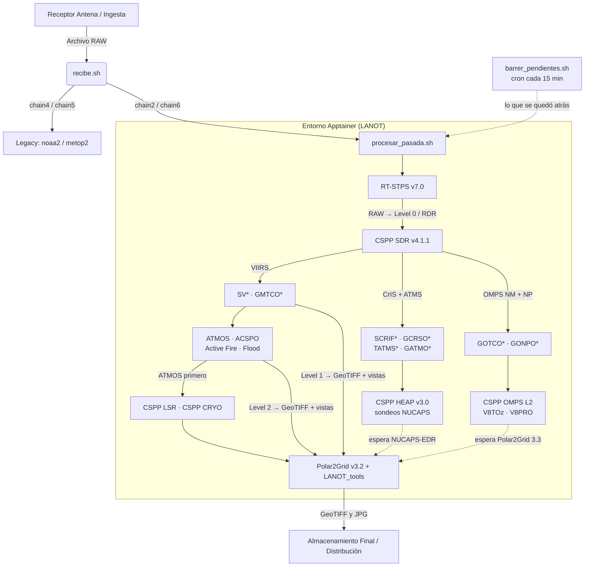

# LANOT_procesamiento_polar

**Orquestación de contenedores Apptainer para el procesamiento operativo de satélites de la serie JPSS (Suomi-NPP, NOAA-20 y NOAA-21).**

  

---

## 📋 Descripción del Proyecto

Este repositorio contiene la "Infraestructura como Código" (IaC) de la cadena de procesamiento de imágenes satelitales polares del **Laboratorio Nacional de Observación de la Tierra (LANOT)**.

El objetivo es migrar de scripts monolíticos en servidor ("bare metal") a una arquitectura modular basada en contenedores **Apptainer** (anteriormente Singularity). Esto garantiza:
* **Reproducibilidad:** Entornos idénticos a los validados por SSEC/Wisconsin.
* **Soporte Moderno:** Capacidad para procesar NOAA-21 (JPSS-2).
* **Aislamiento:** Eliminación de conflictos de bibliotecas entre cadenas de procesamiento antiguas y nuevas.

**No contiene software científico ni datos**: solo recetas, scripts, plantillas XML y documentación. Los tarballs oficiales de CIMSS/SSEC y NASA DRL están listados en el manifiesto `contenedores/tarballs.tsv`.

### 🛰️ Satélites Soportados
* **Suomi-NPP**
* **NOAA-20 (JPSS-1)**
* **NOAA-21 (JPSS-2)**

---

## 🏗️ Arquitectura del Flujo

`recibe.sh` recibe el RAW de la antena y enruta; `procesar_pasada.sh` encadena los once eslabones de una pasada, con barreras entre niveles y hasta tres etapas simultáneas; `barrer_pendientes.sh` va en cron y recoge lo que se quedó atrás.



**Las ramas de Level 2 no comen todas de lo mismo.** CSPP SDR produce cuatro flujos de sensor y
cada rama se alimenta de unos y no de otros:

* **VIIRS** → ATMOS, ACSPO, Active Fire, Flood, LSR, CRYO y los renderizados de Level 1.
* **CrIS + ATMS** → los sondeos hiperespectrales de **NUCAPS**, hoy en CSPP HEAP v3.0. Es la
  única rama que consume **dos** sensores a la vez, y por eso el emparejamiento va por traslape
  de intervalos con margen (`HEAP_MARGEN_ATMS`) y no por clave de pasada. NUCAPS **no** sale de
  VIIRS ni lo cubre ATMOS.
* **OMPS** → ozono, con sus dos instrumentos —Nadir Mapper y Nadir Profiler— procesados en
  llamadas separadas de `run_sdr.sh`.

Las dos flechas punteadas son ramas completas que hoy no publican vista, cada una por su motivo:
CSPP HEAP v3.0 no produce `NUCAPS-EDR` —reportado a CIMSS, y por eso la etapa está comentada en
`procesar_pasada.sh`— y Polar2Grid no trae lector de OMPS hasta la 3.3, que todavía no existe como
bundle. El renderizado de sondeos, en cambio, está escrito y probado de punta a punta con gránulos
de muestra: espera solo al producto.

**La órbita no es común entre instrumentos**: el mismo sobrevuelo es `b45236` en VIIRS y `b45237`
en OMPS. Sirve como clave dentro de un instrumento, nunca para cruzar de uno a otro — para eso,
tiempo.

`geotiff/` son datos (float32) y `vistas/` son JPG decorados con logo y sello de tiempo: no se mezclan.

---

## 🚀 Requisitos Previos

Para desplegar este sistema en un servidor nuevo, se requiere:

*   **Sistema Operativo:** Rocky Linux 8/9 o RHEL compatible.
*   **Motor de Contenedores:** `Apptainer` instalado (`dnf install apptainer`).
*   **Credenciales:** registro en el sitio de descargas de CIMSS/SSEC.

---

## 🛠️ Puesta en marcha

### 1. Clonar y ver qué falta

```bash
git clone https://github.com/LANOT-UNAM/LANOT_procesamiento_polar.git
cd LANOT_procesamiento_polar

./contenedores/obtener_tarballs.sh              # qué falta, qué sobra, qué no cuadra
./contenedores/obtener_tarballs.sh --descargar  # qué bajar y de dónde
```

La descarga es manual: el script dice exactamente qué archivos faltan, de qué sitio salen y dónde dejarlos. `--verificar` confirma después que llegaron completos.

### 2. Compilar las imágenes

Hay **orden de compilación**: todas las recetas parten de una imagen base común. `construir.sh` lo resuelve.

```bash
./contenedores/construir.sh                    # lista lo disponible
./contenedores/construir.sh cspp_sdr_v4.1.1    # compila esa receta y su base

# El destino de los .sif se elige con DESTINO; los scripts los buscan en /opt/containers
DESTINO=/opt/containers ./contenedores/construir.sh polar2grid_v3.2-mapdrawer
```

### 3. Preparar el servidor (una vez)

```bash
./scripts/preparar_servidor.sh --verificar   # audita sin tocar nada
sudo ./scripts/preparar_servidor.sh          # directorios, estáticos, XML, leapsec, cachés
```

Los tarballs de datos estáticos se borran después de extraerlos y comprobar que el destino quedó poblado: son decenas de GB que duplicarían lo que ya vive en `/data/opt`. Los bundles de software sí se conservan, porque son la entrada de `apptainer build`.

### 4. Instalar el código de operación (en cada despliegue)

```bash
sudo ./scripts/instalar.sh    # copia a /opt/lanot/polares
```

En operación la cadena se ejecuta como `lanotadm` desde `/opt/lanot/polares/scripts/`, **no** desde el clon: así un `git pull` o una edición en el servidor no cambian lo que corre el cron. `VERSION` anota de qué commit salió. Si hay una pasada en curso, `instalar.sh` espera a que termine (hasta 45 min, `INSTALAR_ESPERA`), para que ninguna quede hecha con dos versiones.

La recepción invoca `/opt/lanot/polares/scripts/recibe.sh <crudo>` directamente por `ssh`. **Sin enlace en `~lanotadm/bin`**: ahí vive el `recibe.sh` de la cadena vieja.

### 5. Comprobar que hay versión nueva de algún paquete

CSPP no tiene lista de correo ni RSS, así que nadie avisa. La portada sí es pública:

```bash
./contenedores/obtener_tarballs.sh --novedades   # va bien en un cron mensual
```

---

## ⚙️ Mantenimiento Operativo

### Datos ancilares dinámicos
Cada software tiene **su propio caché** bajo `/data/ancillary`, y no se comparten: el podador de ATMOS borra por directorio y se llevaría el de SDR entero. Los refrescan dos tareas de cron, `update_sdr_daily.sh` y `update_atmos_ancillary.sh`.

### Leap seconds
`/data/ancillary/common/leapsec.dat` sale del contenedor de RT-STPS, que es la única fuente con el formato correcto garantizado, y lo refresca `update_sdr_daily.sh`. **Nunca se sustituye por uno improvisado**: un leapsec inventado no falla, fecha mal los datos en silencio.

---

## 🤝 Contribución

Este es un proyecto interno del LANOT. Se trabaja **directo sobre `main`**, sin ramas ni Pull Requests: `tahan` es servidor de desarrollo y no el que está conectado a la antena. El ciclo es editar, `git push`, `git pull` en tahan, `instalar.sh` y correr.

---

## 📜 Licencia y Créditos
*   **Código de Orquestación:** Distribuido bajo licencia GNU GPLv3.
*   **Software Base:**
    *   CSPP (SDR, ATMOS, LSR, CRYO, ACSPO, Active Fire, Flood, OMPS) y Polar2Grid: University of Wisconsin-Madison (SSEC/CIMSS).
    *   RT-STPS: NASA Direct Readout Laboratory (DRL).

---
*Laboratorio Nacional de Observación de la Tierra (LANOT) - UNAM, 2026.*
