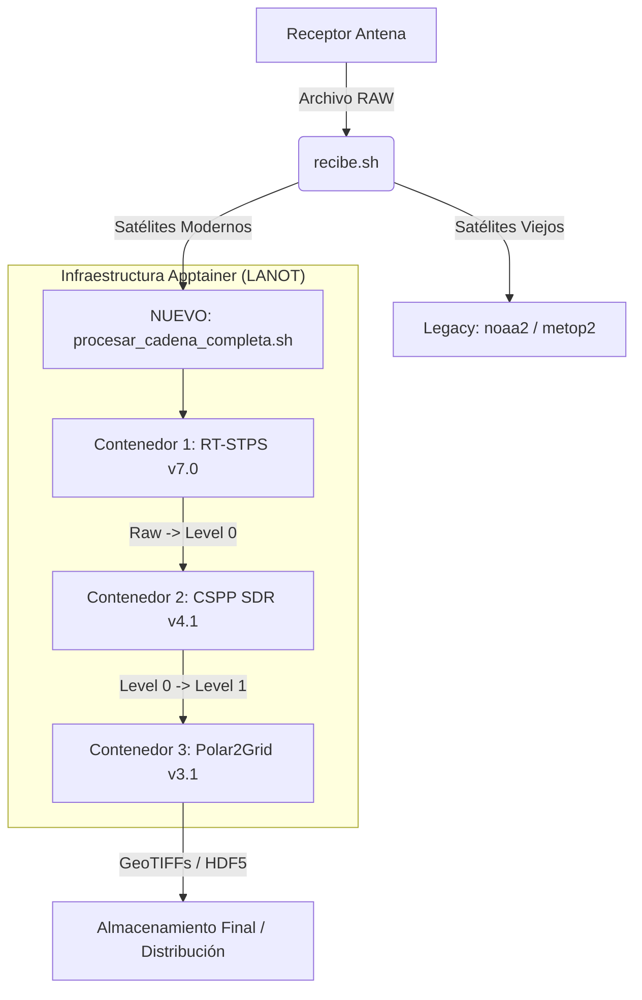

# Plan de Migración a Arquitectura de Contenedores (Apptainer)
**Laboratorio Nacional de Observación de la Tierra (LANOT - UNAM)**
*Proyecto: Modernización de la Cadena de Procesamiento NPP/JPSS (NOAA-20/21)*
*Fecha: Diciembre 2025*

---

## 0. Preparación del Servidor Anfitrión (Host)
*Instrucciones para el servidor físico (Rocky Linux 10 / 9).*

Antes de iniciar, es necesario habilitar el repositorio EPEL e instalar el motor de contenedores y herramientas básicas.

```bash
# 1. Actualizar el sistema base
sudo dnf update -y

# 2. Habilitar repositorio EPEL (Extra Packages for Enterprise Linux)
# Indispensable para instalar Apptainer
sudo dnf install -y epel-release

# 3. Habilitar repositorio CRB (Code Ready Builder) - A veces requerido en Rocky 9/10
sudo /usr/bin/crb enable

# 4. Instalar Paquetes Necesarios
# - apptainer: El motor de contenedores
# - apptainer-suid: Permite correr contenedores sin ser root (importante para seguridad)
# - wget/curl: Para descargar instaladores
# - git: Para control de versiones (opcional)
sudo dnf install -y apptainer apptainer-suid wget curl git

# 5. Verificación
apptainer --version
# Debería mostrar algo como: apptainer version 1.x.x
```

## 1. Resumen Ejecutivo
Este documento detalla la ingeniería para migrar el procesamiento de los satélites de la serie moderna (Suomi-NPP, NOAA-20, NOAA-21) de scripts monolíticos a una arquitectura modular basada en **Apptainer**.

**Objetivos:**
1.  **Soporte NOAA-21:** Integración de RT-STPS v7.0 con Patch 1.
2.  **Aislamiento:** Eliminación de conflictos de **bibliotecas** entre cadenas antiguas y nuevas.
3.  **Estandarización:** Uso de entornos validados por SSEC/Wisconsin (Rocky Linux 8).

### 1.1. Estructura de Directorios del Sistema

La nueva arquitectura utiliza las siguientes ubicaciones estandarizadas:

**Contenedores (Archivos .sif):**
```
/opt/containers/
├── rt_stps_7.0.sif           # Contenedor RT-STPS v7.0 + Patch 1
├── cspp_sdr_v4.1.sif         # Contenedor CSPP SDR v4.1
└── polar2grid_v3.1.sif       # Contenedor Polar2Grid v3.1
```

**Scripts de Orquestación:**
```
~lanotadm/bin/
├── procesar_cadena_completa.sh  # Orquestador principal (satélites modernos)
└── recibe.sh                    # Despachador de tráfico (modificado)
```

**Logs del Sistema:**
```
/var/log/lanot/polares/
├── rt-stps/                  # Logs del contenedor RT-STPS
│   └── YYYYMMDD_HHMMSS_*.log
├── cspp-sdr/                 # Logs del contenedor CSPP SDR
│   └── YYYYMMDD_HHMMSS_*.log
├── polar2grid/               # Logs del contenedor Polar2Grid
│   └── YYYYMMDD_HHMMSS_*.log
└── orquestador/              # Logs del script principal
    └── YYYYMMDD_*.log
```

**Datos de Trabajo:**
```
/data/
├── ancillary/common/         # Archivos auxiliares (leapsec.dat, etc.)
├── raw/                      # Archivos RAW recibidos de antena
├── work/                     # Procesamiento temporal
└── products/                 # Productos finales (GeoTIFF, HDF5)
```

**Nota:** Crear la estructura de logs antes de la primera ejecución:
```bash
sudo mkdir -p /var/log/lanot/polares/{rt-stps,cspp-sdr,polar2grid,orquestador}
sudo chown -R lanotadm:lanotadm /var/log/lanot
```

---

## 2. Nueva Arquitectura de Flujo

El sistema reemplaza el script monolítico `cspp.sh` por un orquestador que gestiona tres contenedores especializados.


    
## 3. Prerrequisitos de Instalación

Antes de compilar, descargar los siguientes archivos oficiales y el archivo de segundos intercalares.

A. Archivos de Software (Colocar en carpeta de compilación):

RT-STPS_7.0.tar.gz (Base)

RT-STPS_7.0_PATCH_1.tar.gz (Parche Crítico JPSS-2)

CSPP_SDR_V4.1.tar.gz (Procesador SDR)

CSPP_POLAR2GRID_V3.1.tar.gz (Visualizador)


``` Plaintext
~/contenedores_build/
├── cspp_sdr_v4.1.def            <-- El código que te di
├── CSPP_SDR_V4.1.tar.gz         <-- Descargado de CIMSS
│
├── rt_stps_7.0.def              <-- El código que te di
├── RT-STPS_7.0.tar.gz           <-- Descargado (verifica el nombre exacto)
├── RT-STPS_7.0_PATCH_1.tar.gz   <-- Descargado (el parche crítico)
│
├── polar2grid_v3.1.def          <-- El código que te di
└── CSPP_POLAR2GRID_V3.1.tar.gz  <-- Descargado de CIMSS
```

B. Archivo Auxiliar (Actualizar manualmente):

Descargar leapsec.dat desde: ftp://is.sci.gsfc.nasa.gov/ancillary/temporal/leapsec.dat

``` Bash
# Ejecutar en la carpeta de descarga
tar -zxf RT-STPS_7.0.tar.gz rt-stps/leapsec.dat
mkdir -p /data/ancillary/common/
mv rt-stps/leapsec.dat /data/ancillary/common/leapsec.dat
rmdir -p rt-stps
```

Ubicación final en servidor: /data/ancillary/common/leapsec.dat

## 4. Definición de Contenedores (.def)

Crear estos tres archivos y compilarlos con sudo apptainer build nombre.sif archivo.def.

4.1. Contenedor Nivel 0: rt_stps_7.0.def
Aplica el parche 1 para habilitar NOAA-21 y fuerza el uso de Java 11.

4.2. Contenedor Nivel 1: cspp_sdr_v4.1.def
Entorno oficial de procesamiento SDR.

4.3. Contenedor Visualización: polar2grid_v3.1.def

4.4. Comandos de Compilación y Verificación
Ejecutar los siguientes comandos. Si el contenedor se construye y funciona correctamente, imprimirá la ayuda del software instalado.

A. Construcción (Requiere privilegios sudo):
``` Bash
# 1. Compilar RT-STPS
sudo apptainer build rt_stps_7.0.sif rt_stps_7.0.def

# 2. Compilar CSPP SDR
sudo apptainer build cspp_sdr_v4.1.sif cspp_sdr_v4.1.def

# 3. Compilar Polar2Grid
sudo apptainer build polar2grid_v3.1.sif polar2grid_v3.1.def
```
B. Pruebas de Funcionamiento (Sanity Checks):
``` Bash
echo "--- Probando RT-STPS ---"
# Debe mostrar las opciones de uso de batch.sh sin errores de Java
apptainer exec rt_stps_7.0.sif ./bin/batch.sh --help

echo "--- Probando CSPP SDR ---"
# Debe mostrar la ayuda del script de VIIRS
apptainer exec cspp_sdr_v4.1.sif viirs_sdr.sh --help

echo "--- Probando Polar2Grid ---"
# Debe listar los 'readers' disponibles (debe aparecer viirs_sdr)
apptainer exec polar2grid_v3.1.sif polar2grid.sh --list-readers
```


## 5. El Nuevo Orquestador
Este script (`procesar_cadena_completa.sh`) gestiona la lógica de negocio y coordina los tres contenedores.

**Ubicación:** `~lanotadm/bin/procesar_cadena_completa.sh`

**Variables de Configuración:**
```bash
# Rutas de contenedores
RT_STPS_CONTAINER="/opt/containers/rt_stps_7.0.sif"
CSSP_SDR_CONTAINER="/opt/containers/cspp_sdr_v4.1.sif"
POLAR2GRID_CONTAINER="/opt/containers/polar2grid_v3.1.sif"

# Directorios de logs
LOG_DIR="/var/log/lanot/polares/orquestador"
RT_STPS_LOG_DIR="/var/log/lanot/polares/rt-stps"
CSSP_SDR_LOG_DIR="/var/log/lanot/polares/cspp-sdr"
POLAR2GRID_LOG_DIR="/var/log/lanot/polares/polar2grid"

# Directorios de trabajo
WORK_DIR="/data/work"
ANCILLARY_DIR="/data/ancillary"
OUTPUT_DIR="/data/products"
```

## 6. Estrategia de Transición (recibe.sh)
Este script es notificado cuando se recibe un archivo RAW nuevo y enruta el tráfico según el satélite.

**Ubicación:** `~lanotadm/bin/recibe.sh`

**Lógica de Enrutamiento:**
```bash
#!/bin/bash
# Recibe notificación de nuevo archivo RAW y despacha según satélite

RAW_FILE="$1"
SATELLITE=$(detectar_satelite "$RAW_FILE")

case "$SATELLITE" in
    "npp"|"noaa20"|"noaa21")
        # Satélites modernos -> Nueva cadena con contenedores
        ~lanotadm/bin/procesar_cadena_completa.sh "$RAW_FILE" 2>&1 | \
            tee -a /var/log/lanot/polares/orquestador/$(date +%Y%m%d)_recibe.log
        ;;
    "noaa15"|"noaa18"|"noaa19"|"metop-a"|"metop-b"|"metop-c")
        # Satélites legacy -> Cadena antigua (noaa2/metop2)
        /opt/legacy/cspp.sh "$RAW_FILE"
        ;;
    *)
        echo "ERROR: Satélite desconocido: $SATELLITE" >&2
        exit 1
        ;;
esac
```

## 7. Mantenimiento y Monitoreo

### 7.1. Logs del Sistema

Todos los logs se centralizan en `/var/log/lanot/polares/` para facilitar auditorías y depuración.

**Ubicaciones por componente:**
```bash
# Logs del orquestador principal
/var/log/lanot/polares/orquestador/YYYYMMDD_*.log

# Logs de cada contenedor (por ejecución)
/var/log/lanot/polares/rt-stps/YYYYMMDD_HHMMSS_satelite.log
/var/log/lanot/polares/cspp-sdr/YYYYMMDD_HHMMSS_satelite.log
/var/log/lanot/polares/polar2grid/YYYYMMDD_HHMMSS_satelite.log
```

**Comandos útiles para diagnóstico:**
```bash
# Ver últimos errores del día
grep -i error /var/log/lanot/polares/orquestador/$(date +%Y%m%d)_*.log

# Monitorear procesamiento en tiempo real
tail -f /var/log/lanot/polares/orquestador/$(date +%Y%m%d)_*.log

# Listar fallos de las últimas 24 horas
find /var/log/lanot/polares -name "*.log" -mtime -1 -exec grep -l "ERROR\|FAILED" {} \;
```

**Rotación de logs (configurar logrotate):**
```bash
# Crear /etc/logrotate.d/lanot-polares
/var/log/lanot/polares/*/*.log {
    daily
    rotate 30
    compress
    delaycompress
    missingok
    notifempty
    create 0640 lanotadm lanotadm
}
```

### 7.2. Archivos Auxiliares Críticos

**Leap Seconds (Actualizar cada 6 meses):**
```bash
# Descargar versión actualizada
wget -O /data/ancillary/common/leapsec.dat \
    ftp://is.sci.gsfc.nasa.gov/ancillary/temporal/leapsec.dat

# Verificar última fecha
tail -1 /data/ancillary/common/leapsec.dat
```

**Datos Auxiliares LUTs (Automatizar con cron):**
```bash
# Configurar en crontab de lanotadm
# Ejecutar todos los lunes a las 3 AM
0 3 * * 1 apptainer exec /opt/containers/cspp_sdr_v4.1.sif \
    ancillary_download.sh /data/ancillary 2>&1 | \
    tee -a /var/log/lanot/polares/orquestador/ancillary_update.log
```

### 7.3. Verificación de Integridad de Contenedores

```bash
# Verificar checksums después de actualizaciones del sistema
cd /opt/containers
sha256sum *.sif > checksums.txt

# Validar funcionamiento básico
apptainer exec rt_stps_7.0.sif ./bin/batch.sh --version
apptainer exec cspp_sdr_v4.1.sif viirs_sdr.sh --version
apptainer exec polar2grid_v3.1.sif polar2grid.sh --version
```


